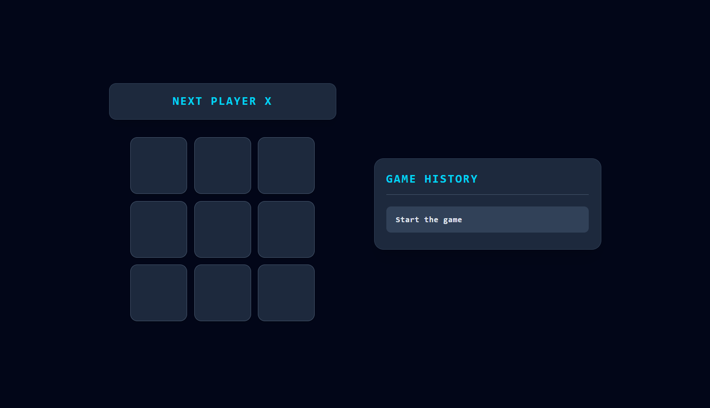

# Tic-Tac-Toe

A classic two-player Tic-Tac-Toe game built with React, featuring interactive gameplay, winner detection, and move history navigation.



**Live Demo :** [Play Tic-Tac-Toe](https://your-tic-tac-toe.vercel.app/)

## Features

- Interactive 3×3 game board
- Two-player gameplay (X and O)
- Automatic winner detection
- Prevention of moves on occupied squares
- Game history tracking
- Time-travel navigation to previous moves
- Responsive dark arcade-style interface

<<<<<<< HEAD
<p align="center">
  
</p>
=======
## Tech Stack
>>>>>>> 527165d (chore: finalize project and polish UI and documentation)

- **Frontend:** React, JavaScript (ES6+)
- **Styling:** Tailwind CSS
- **Build Tool:** Vite
- **Deployment:** Vercel
- **Version Control:** Git, GitHub

<<<<<<< HEAD
- 🎯 Interactive 3×3 game board
- ❎ Two-player gameplay with alternating X and O turns
- 🏆 Automatic winner detection
- 🛡️ Prevents moves on occupied squares and after a winner is declared
- 🕘 Game history tracking
- ⏪ Time-travel navigation to revisit previous moves
- 📱 Responsive interface with a dark arcade-inspired design

## 🧰 Tech Stack

- **React** - UI components and state management
- **JavaScript (ES6+)** - game logic
- **Tailwind CSS** - styling
- **Vite** - development server and build tool
- **Vercel** - deployment

## 🚀 Getting Started
=======
## Getting Started
>>>>>>> 527165d (chore: finalize project and polish UI and documentation)

### Prerequisites

- Node.js
- npm

### Installation

Clone the repository:

```bash
git clone https://github.com/sasamir10/tic-tac-toe.git
```

Navigate to the project directory:

```bash
cd tic-tac-toe
```

Install dependencies:

```bash
npm install
```

### Run

Start the development server:

```bash
npm run dev
```

Open your browser and visit:

```text
http://localhost:5173/
```

## Project Structure

```text
tic-tac-toe/
├── public/
├── src/
│   ├── assets/
│   │   └── icon.png
│   ├── components/
│   │   └── Square.jsx
│   ├── App.jsx
│   ├── index.css
│   └── main.jsx
├── index.html
├── package-lock.json
├── package.json
├── README.md
└── vite.config.js
```

## Learning Objectives

This project was built as a React practice project following the official React documentation, focusing on:

- React components and props
- State management with `useState`
- Event handling
- Conditional rendering
- Lifting state up
- Immutable state updates
- Rendering lists using `map()`

## Author

**Sabbir Ahmed Samir**

- GitHub : [@sasamir10](https://github.com/sasamir10)
- LinkedIn : [Sabbir Ahmed Samir](https://linkedin.com/in/sabbirahmed10)
